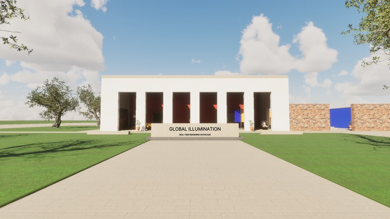
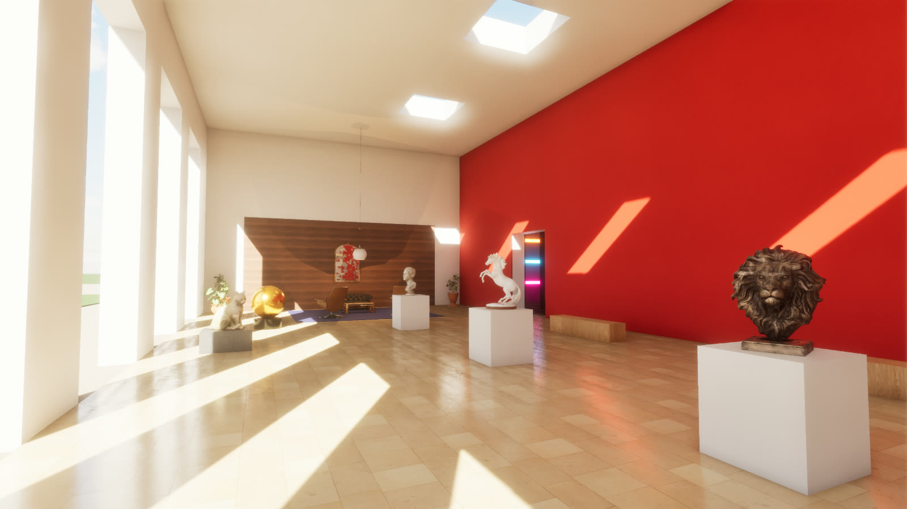
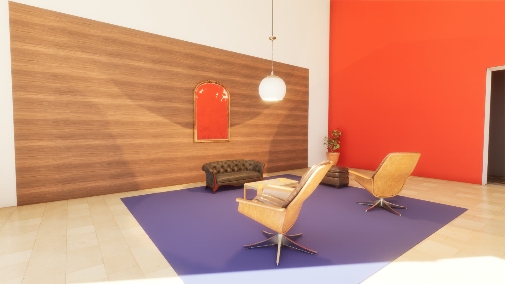
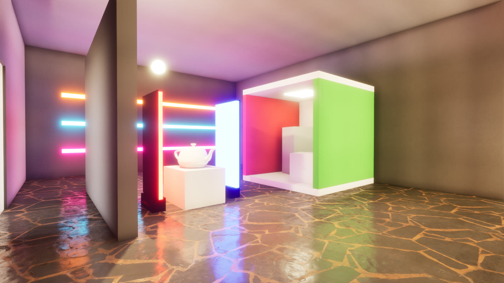
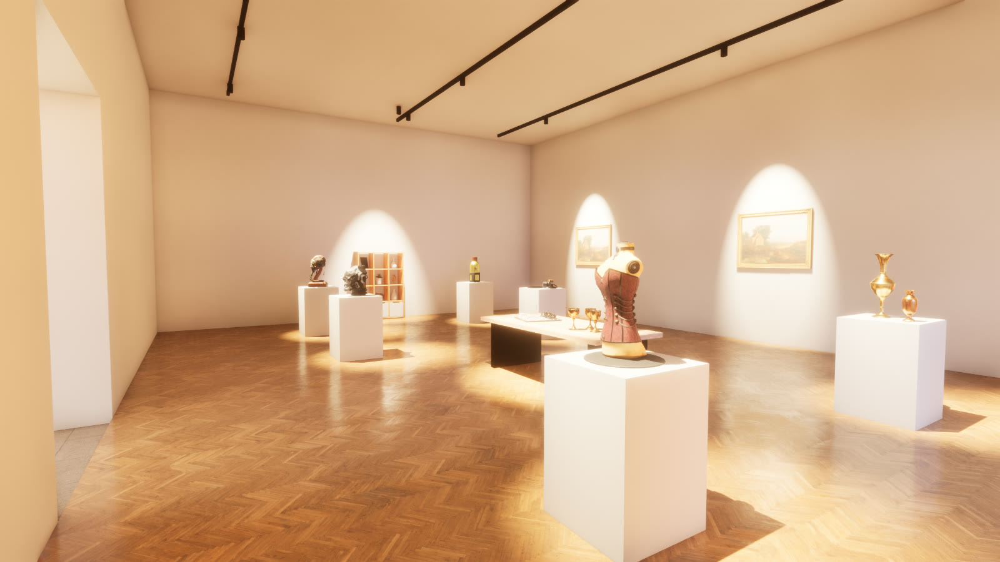
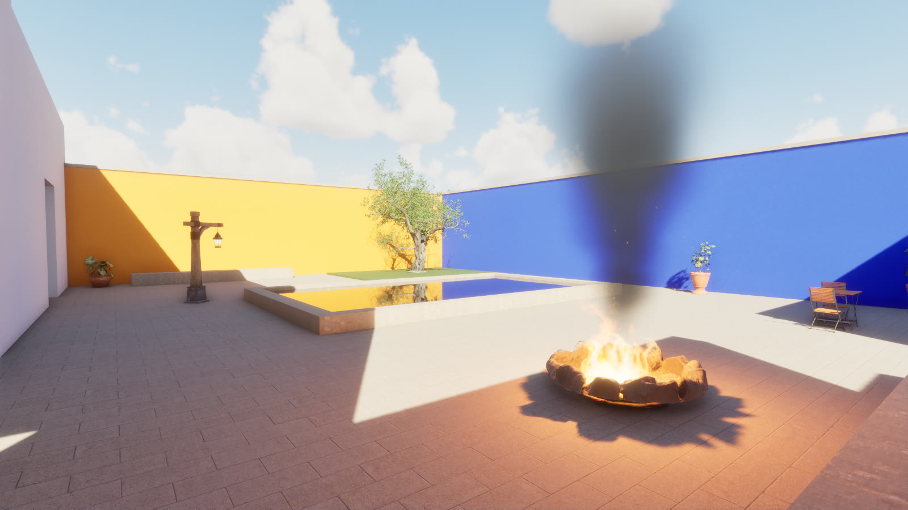
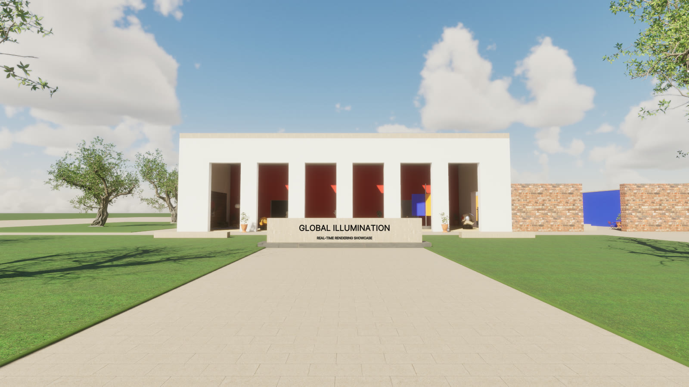

# GI Showcase

A walk through a grand hall, a light lab, a gallery, a courtyard and a plaza, lit by the sun, emissive surfaces and
lights alone. It shows the engine's dynamic global illumination and reflections, emissive light, and a sun you can
sweep through the day. A sample project for [Unravel Engine](https://github.com/unravel-dev/UnravelEngine).

## Play

Clone this repository, or get it from the Samples page of the Unravel editor's start page, and open its folder in
the editor. Open `data/GI_Showcase.spfb` and press Play; it is also the startup scene of a deployed build. The camera
tours the five areas by itself and stops at the views worth a look; free flight takes over at any time.

| Action | Keyboard and mouse | Gamepad | Touch |
|---|---|---|---|
| Pause or resume the tour | P | - | - |
| Next view | N | - | - |
| Free flight on or off | F | - | - |
| Fly | Hold the right mouse button to look, W A S D or arrows to move, Q / E down and up, the wheel for speed | Left stick moves | - |
| Sweep the sun through the day, or stop it | T | - | - |
| Put the sun back where it was placed | R | - | - |

P and N wait while you fly; leaving free flight puts the camera back on the tour where it stopped. On a touch screen
the tour plays by itself.

## What it shows

- **Grand hall**: a marble floor, white stucco walls and a south wall of openings, a red stucco lining for colour
  bleed, chrome and gold spheres for reflections, sculptures on plinths, and a kinetic sculpture whose red, yellow and
  blue vanes sweep sunlight and coloured bounce light around the room (`Spinner.cs`). A lounge with walnut panels, a
  rug, a sofa, a mirror and a warm pendant lamp.
- **Light lab**: a charcoal room lit mostly by emissive surfaces. A Cornell box with red and green walls and an
  emissive ceiling panel and no light at all, a teapot between red and blue emissive blades, magenta, cyan and amber
  neon tubes, and an emissive orb with a point light orbiting through it all (`OrbitMover.cs`).
- **Gallery**: a parquet floor under warm spot lights on ceiling tracks, over glTF exhibits, paintings and shelves.
- **Courtyard**: brick, cobalt and ochre walls around a reflecting pool, and a fire pit whose point light flickers
  (`LightFlicker.cs`) over flame, smoke and ember particles and an emissive coal bed.
- **Plaza**: a concrete monolith with 3D text, benches, trees and lawns under a sky with volumetric clouds.
- **The sun** (`SunCycle.cs`): T sweeps it around the sky once a minute between 12 and 58 degrees of elevation, so the
  bounce light of every area changes as you watch.
- **Settings**: global illumination with screen traces for diffuse light and reflections at Epic quality, screen-space
  reflections, ambient occlusion, temporal anti-aliasing, bloom and auto exposure in the scene's global volume, a
  Perez sky with an atmosphere sun, and a global reflection probe.

## Screenshots

| | |
|---|---|
|  |  |
|  |  |
|  |  |

## Project layout

| Path | What it holds |
|---|---|
| `data/GI_Showcase.spfb` | The scene: the five areas, the camera tour's waypoints, the sky and the global volume. |
| `data/scripts/ShowcaseCamera.cs` | The camera tour and free flight. |
| `data/scripts/SunCycle.cs` | Sweeps the sun and puts it back. |
| `data/scripts/OrbitMover.cs`, `Spinner.cs`, `LightFlicker.cs` | The lab's orb, the hall's kinetic sculpture, the fire's light. |
| `data/Materials/` | The materials of the walls, floors and props. |
| `data/Models/Khronos/`, `data/Models/PolyHaven/` | The glTF exhibits and props. |
| `data/Textures/` | The texture sets, the fire pit's maps and the particle sheets. |

Walls, plinths and similar shapes are the engine's built-in meshes.

## Platforms

| Profile | Notes |
|---|---|
| Desktop | Windows or Linux, as the editor runs on; global illumination and reflections at Epic quality. |
| Android | Global illumination at High quality with a smaller surface cache, and no screen-space reflections, ambient occlusion or soft and contact shadows. |

Deploy from the editor's Deploy window with a profile from `profiles/`.

## Credits

| Asset | Author | License | Source |
|---|---|---|---|
| 36 models and 12 texture sets (`data/Models/PolyHaven/`, `data/Textures/`) | Poly Haven artists | CC0 1.0 | https://polyhaven.com |
| 7 glTF sample models (`data/Models/Khronos/`) | Microsoft, Gary Hsu, sbtron, Michael Pavlovic, Eric Chadwick | CC0 1.0 | Khronos glTF Sample Assets |

Every asset is listed with its authors in [CREDITS.md](CREDITS.md). The 3D text uses the Inter typeface that ships
with the engine. Code and all other content are under the MIT license in [LICENSE](LICENSE).
